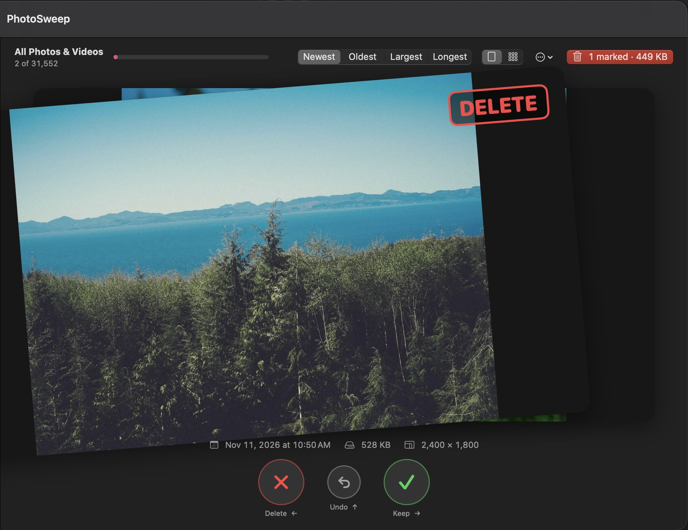

# PhotoSweep

A small Mac app for clearing out your Photos library. It shows one photo or video at a time, and you swipe left to delete or right to keep, until the queue is empty.

It was built to free up a full iCloud account. A Photos library fills up with screenshots, screen recordings, long videos and accidental duplicates, and going through them in the Photos app is slow. PhotoSweep puts those in queues and lets you go through them with the arrow keys.



## How it keeps your library safe

Swiping never deletes anything. Deleting takes four separate steps, and you can back out at each one.

1. **Swiping left only adds the item to a delete list.** The list is saved between launches. Undo takes the last swipe back.
2. **You review the list.** The red button at the top right opens a grid of everything you marked. Click any item to take it off the list and keep it.
3. **macOS asks you to confirm.** When you click Delete, the system shows its own confirmation with the number of items. PhotoSweep cannot skip it.
4. **Deleted items go to Recently Deleted.** Photos keeps them there for 30 days, and you can recover them from the Photos app.

**To actually free iCloud space**, open Photos, choose Recently Deleted in the sidebar, and click Delete All. Until you do, the items still count against your storage.

PhotoSweep makes no network connections of its own. It has no accounts, analytics or third-party code. Photos and videos that live in iCloud are loaded through Apple's Photos framework, the same way the Photos app loads them.

## What you can sort through

The sidebar has three groups:

- **Cleanup**: any album whose name starts with "Cleanup" is pinned here at the top. Make an album like "Cleanup - Trip videos" in Photos to give yourself a short queue.
- **Library**: Duplicates, Screenshots, Screen Recordings, Videos, Live Photos, and All Photos & Videos.
- **Albums**: your other albums.

Hidden items and shared albums are never shown. Empty albums are left out.

A switch at the top of the sidebar chooses what you go through:

- **Left to swipe** (the default) shows only the items you have not decided on yet. Once you keep or mark an item it is skipped in every queue, so you never see it twice.
- **All items** shows everything in the queue again, including what you already kept or marked. A small label on the card says "Kept" or "On delete list", and swiping it again changes the decision.

The number next to each queue follows the switch.

Each queue can be ordered by Newest, Oldest, Largest (by file size) or Longest (videos). The first time you sort a big queue by Largest, the app has to measure file sizes, which can take a minute. The sizes are remembered after that.

### Cards or grid

The two-part switch in the header changes how the open queue is shown.

- **Cards** shows one item at a time, for when you need to look at each one.
- **Grid** shows thumbnails, for when a glance is enough, such as screenshots. Click a thumbnail to mark it for deletion; it turns red. Click it again to take the mark off. Press Space, or double-click, to see an item large, where videos play.

In the grid you only click what you want gone. **Keep the Rest…** at the bottom then keeps everything you did not mark, so the queue is finished.

Marking in the grid does the same thing as swiping left: it adds the item to the delete list and nothing else.

### Duplicates

The Duplicates queue finds items stored more than once: same type, same pixel size, same capture time to the second, same video length, and the same file size. It only finds exact copies. It does not look for photos that are merely similar.

For each set of copies it keeps one and puts the others in the queue. It prefers to keep a favorite, and it never picks a copy you have already marked for deletion if another copy exists. The queue only appears when there is something in it, and the scan runs in the background after launch.

## Controls

| Action | Keyboard | Mouse or trackpad |
| --- | --- | --- |
| Mark for deletion | ← | Drag the card left, or two-finger swipe left |
| Keep | → | Drag the card right, or two-finger swipe right |
| Undo | ↑ or ⌘Z | Undo button |
| Play or pause a video | Space | Play button on the card |
| Mute or unmute | M | Speaker button on the card |
| Re-read albums and counts from Photos | ⌘R | Refresh button in the sidebar |

In the grid, the keys work like a file browser instead:

| Action | Keyboard | Mouse or trackpad |
| --- | --- | --- |
| Mark for deletion, or take the mark off | Delete | Click the thumbnail |
| Move between thumbnails | Arrow keys | |
| See an item large, and go back | Space or Return (Esc also goes back) | Double-click, or the arrows button on a thumbnail |
| Undo | ⌘Z | |

Videos play muted and loop. The next video or two are loaded ahead of time so they usually start right away; on a slow connection, or if you swipe quickly, a video stored in iCloud can still take a moment.

The "…" menu next to the sort control has **Mark All Remaining for Deletion**, which adds every undecided item left in the open queue to the delete list after a confirmation. Items you already kept stay kept. It does not delete anything, and Undo takes the whole batch back off.

## Requirements

- A Mac with the Photos app and a Photos library.
- Apple's Command Line Tools. Full Xcode is not needed.
- Tested on macOS 27.2 with Swift 6.4. The package is set to allow macOS 14 and later and needs Swift 6.0 or later, but older versions have not been tried.

## Build and run

There is no download. You build the app from source, which takes about a minute.

1. Install Apple's Command Line Tools, if you do not have them:

   ```sh
   xcode-select --install
   ```

2. Download or clone this repository, then open Terminal in its folder.

3. Build the app:

   ```sh
   ./scripts/build-app.sh
   ```

4. Open it:

   ```sh
   open build/PhotoSweep.app
   ```

The first time, macOS asks whether PhotoSweep may access your photos. It needs full access to show your library and to delete what you confirm.

You can move `build/PhotoSweep.app` to your Applications folder if you want to keep it.

### Things to know about building it yourself

- The app is signed "ad hoc", meaning it is not tied to a developer account. Because of that, **macOS may ask for Photos access again each time you rebuild**. Your progress is not affected.
- If Photos access was denied, turn it on in System Settings → Privacy & Security → Photos.

## Where your progress is kept

Decisions and totals are stored on your Mac, in:

```
~/Library/Application Support/PhotoSweep/
```

- `state.json` holds what you kept, what is on the delete list, and the running totals.
- `sizes.json` is a cache of file sizes, so they are only measured once.

Nothing is written into your Photos library except the deletions you confirm.

To start over:

- **Reset Progress…** at the bottom of the sidebar clears every keep and delete decision, so all items come back into the queues. The "deleted so far" totals stay. Your library is not changed.
- To wipe everything, quit the app and delete the folder above.

## Known limits

- **File sizes come from a value Apple does not document.** PhotoKit has no public way to ask how big an item is, so the app reads a `fileSize` value from each item's resources. It works on the tested system, but Apple could change it. If it is unavailable the app shows "size unknown", the Largest sort has nothing to sort by, and the Duplicates queue stays empty, because a duplicate is only confirmed when file sizes match.
- **It has only been tested on one setup** (macOS 27.2, Swift 6.4, Apple Silicon, a large library stored in iCloud Photos).
- **The window is English only.**

## For contributors

```sh
swift build
swift test
```

- `Sources/SweepCore` holds the logic that does not touch Photos: the queue and undo history, saved decisions, the sidebar counts, and duplicate grouping. All of the tests cover this part.
- `Sources/PhotoSweep` is the app: PhotoKit access and the SwiftUI views.
- There are no dependencies.

The app has a read-only self-test that checks it against your real library without changing anything or touching saved progress. It writes a JSON report and quits:

```sh
open build/PhotoSweep.app --args --selftest /tmp/photosweep-selftest.json
```

Two things in the code look odd on purpose. Both are there so the project builds with only the Command Line Tools installed:

- View state is declared as `State<T>(initialValue:)` with a small computed accessor instead of `@State`. In the tested SDK, `@State` is a macro whose compiler plugin ships only with full Xcode.
- All tests are in a single file. With more than one test file, the build could not find the Swift Testing macro plugin.

## License

MIT. See [LICENSE](LICENSE).

PhotoSweep is an independent project. It is not affiliated with other apps that use the same or a similar name.
